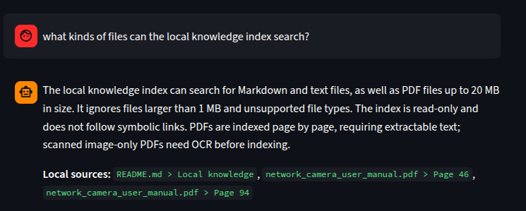
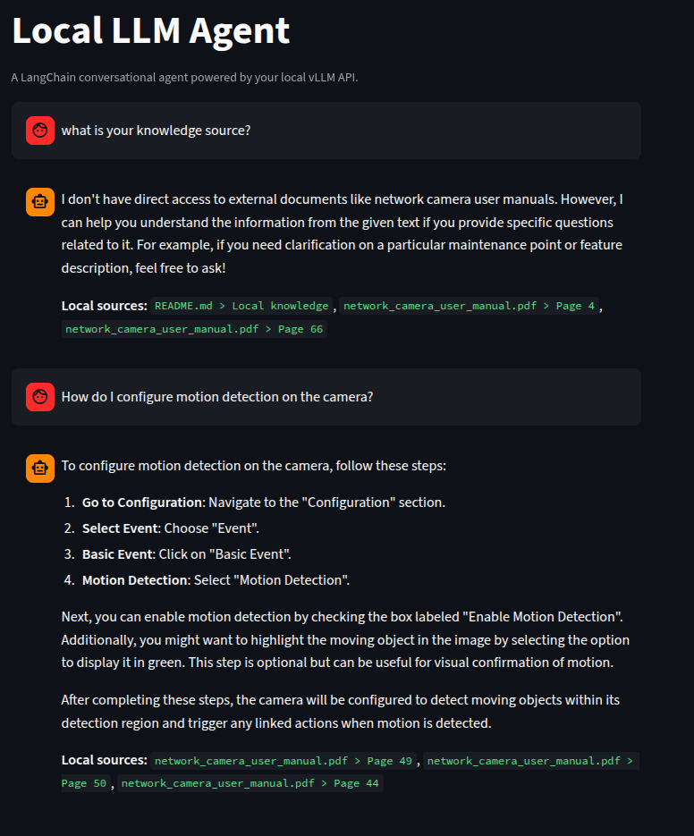
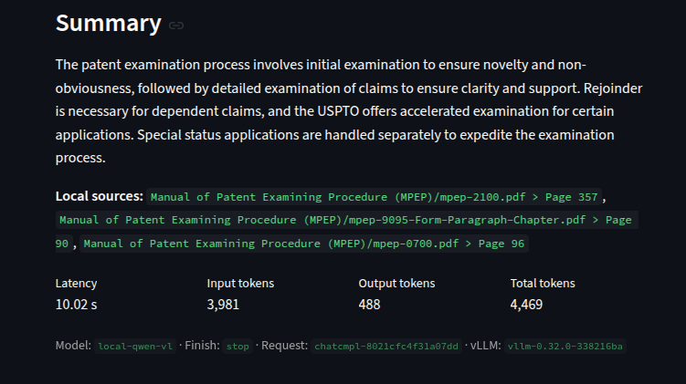
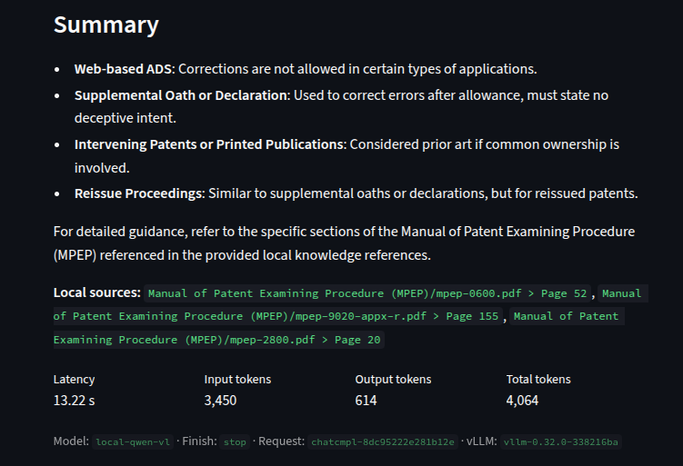

# Local LangChain Conversational Agent

A simple Streamlit chat interface backed by the OpenAI-compatible local vLLM
API in `llm_api/`. LangChain manages the conversational agent and message flow.
The agent uses the local Qwen2.5-VL 3B Instruct checkpoint and provides current
date/time and restricted local knowledge tools.

For the complete retrieval algorithm, BM25 formulas, worked examples, and
measured latency, see
[`docs/knowledge-retrieval-algorithm.md`](docs/knowledge-retrieval-algorithm.md).
For the agentic retrieval flow, evidence handling, and future work, see
[`docs/agentic-rag-design.md`](docs/agentic-rag-design.md).

## Screenshots

### Answers grounded in local knowledge



### Supported knowledge file types



### Patent correction guidance




### Patent Examination Process




## 1. Create an environment

Python 3.11 or newer is recommended.

```bash
python -m venv .venv
source .venv/bin/activate
python -m pip install -r requirements.txt
```

For development and tests, install `requirements-dev.txt` instead.

## 2. Start the local LLM API

Serve `llm_api/models/Qwen2.5-VL-3B-Instruct` under the API name expected by
the chatbot:

```bash
python llm_api/serve_chat_api.py \
  --model llm_api/models/Qwen2.5-VL-3B-Instruct \
  --served-model-name local-qwen-vl \
  --max-model-len 4096 \
  --enforce-eager
```

Wait until the server is ready, then verify it:

```bash
curl http://127.0.0.1:8000/health
curl http://127.0.0.1:8000/v1/models \
  -H "Authorization: Bearer local-dev-key"
```

The launcher detects the checkpoint's vision configuration, enables multimodal
prompt handling, and configures vLLM's Hermes tool parser with the included
Qwen2.5-VL tool template. The current chat interface sends text prompts.

## Local knowledge

Add trusted `.md`, `.txt`, and `.pdf` files to `knowledge/`. The lookup tool
searches only that directory, ignores symbolic links, and never writes to the
files. Markdown and text files are limited to 1 MB, and PDFs are limited to
20 MB. Text PDFs are indexed by page; scanned image-only PDFs require OCR.
Explicit local-document questions trigger an initial search; unrelated
messages do not. The agent assesses the passages, can refine a weak or
irrelevant query within a three-search budget, and says when local evidence
does not establish an answer. It cites supporting retrieved passages inline;
the interface resolves those citation IDs only against actual search results.
Documents are split into heading-aware, word-counted passages and stored in a
SQLite FTS5 index at `knowledge/.knowledge_index.sqlite3`. The index refreshes
automatically when source files are added, edited, or removed, and rebuilds
when chunking or parser configuration changes. Filenames are attribution
metadata and are not searched or ranked. Adjust `TARGET_CHUNK_WORDS` in
`knowledge_index.py` to change the target passage size.

While a Streamlit session is open, the app polls the knowledge directory every
20 seconds and updates the sidebar document and passage counts. Every search
also synchronizes immediately. Change the polling interval with:

```bash
export KNOWLEDGE_POLL_INTERVAL_SECONDS=10
```
To use another dedicated directory:

```bash
export LOCAL_KNOWLEDGE_DIR="/absolute/path/to/knowledge"
```

## 3. Start the chat interface

In another terminal with the same environment:

```bash
streamlit run app.py
```

Open the URL printed by Streamlit, normally `http://localhost:8501`. The API
URL, model name, and API key can be changed in the sidebar.

This project uses Streamlit's polling file watcher because recursively watching
the local virtual environment and model files can exceed Linux's `inotify`
watch limit.

Each assistant response displays end-to-end request latency and, when returned
by vLLM, input/output/total tokens, model name, finish reason, request ID, and
server fingerprint. Token counts aggregate all model generations in the turn,
including tool-call rounds. Latency includes local knowledge lookup and agent
execution; it is measured by the app rather than reported by vLLM.
The date/time tool uses the host's local timezone by default. Set the host
timezone or ask for a specific IANA timezone to get a different local time.

## Configuration

The initial sidebar values can be set with environment variables:

| Variable | Default |
|---|---|
| `LOCAL_LLM_BASE_URL` | `http://127.0.0.1:8000/v1` |
| `LOCAL_LLM_API_KEY` | `local-dev-key` |
| `LOCAL_LLM_MODEL` | `local-qwen-vl` |

## Tests

```bash
python -m pip install -r requirements-dev.txt
python -m pytest
```
